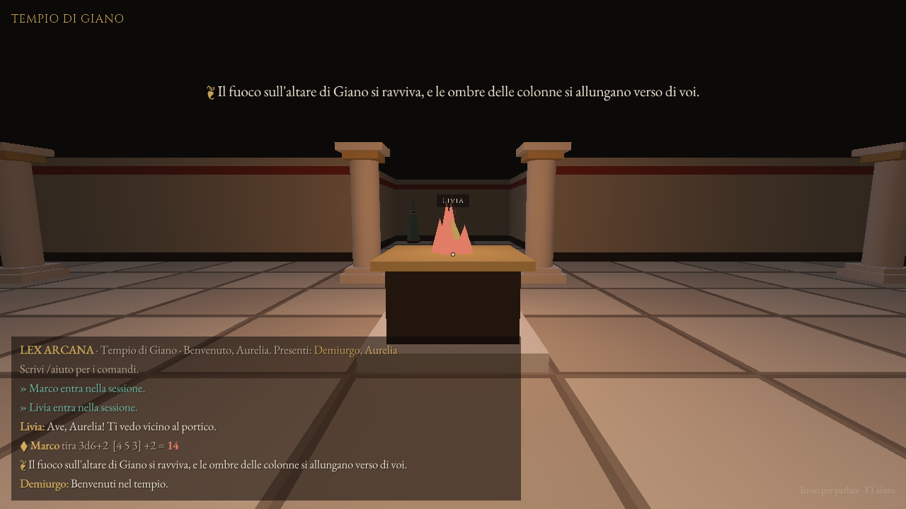
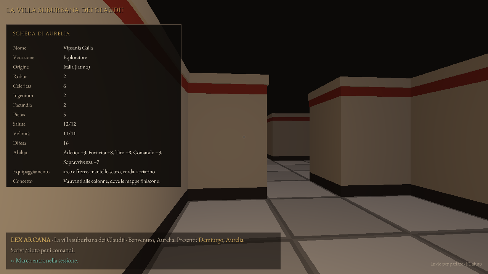
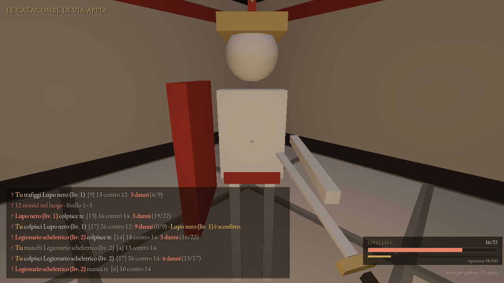
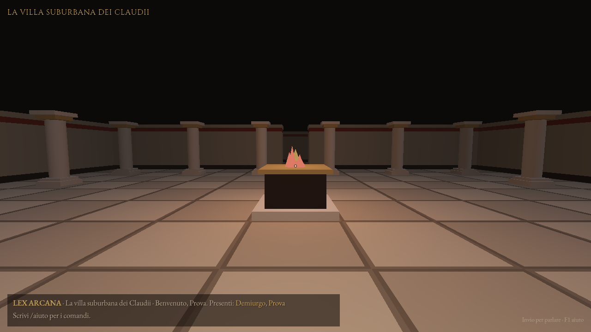
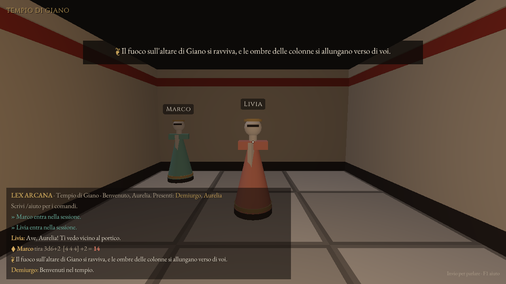
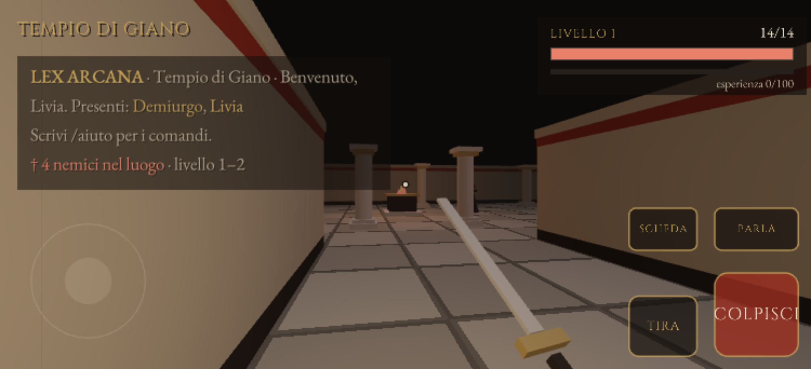
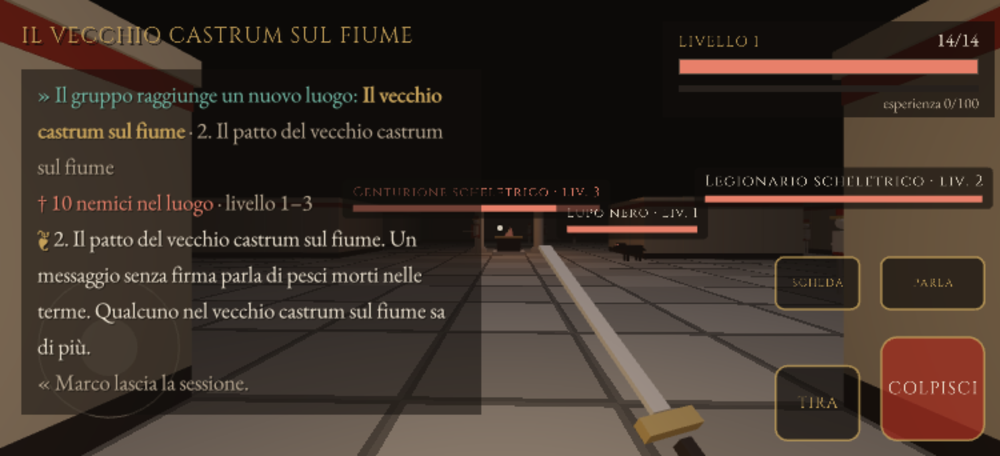

# Lex Arcana

Un tavolo da gioco in rete per giocare di ruolo. Il **Demiurgo** apre la sessione come server dal proprio terminale e i **giocatori** si collegano come client da altri computer. Ci sono chat, narrazione, sussurri, tiri di dado fatti dal server (nessuno può barare) e schede dei personaggi condivise.

I giocatori possono collegarsi in due modi:

- **`lexarcana-visione`**: una finestra 3D in prima persona. Cammini nel luogo scelto dal Demiurgo e vedi gli altri personaggi muoversi intorno a te. Chat e comandi restano nella finestra.
- **`lexarcana client`**: solo testo, nel terminale.



Ci sono anche:

- un **creatore di personaggi**, guidato o casuale;
- un **generatore di campagne**, che scrive il manuale del Demiurgo e la **mappa 3D di ogni avventura**.

Richiede **.NET 10** (C# 14).

> Lex Arcana è un progetto indipendente. Regole, testi, generatori e mappe sono originali: non riproduce il regolamento né le avventure di altri giochi di ruolo.

## Una serata in quattro comandi

Il Demiurgo prepara la campagna:

```bash
dotnet run --project src/LexArcana -- campagna --seme 42 --avventure 5
```

Ogni giocatore crea il suo personaggio:

```bash
dotnet run --project src/LexArcana -- personaggio --nome Aurelia
```

Il Demiurgo apre la sessione:

```bash
dotnet run --project src/LexArcana -- server --campagna campagne/il-culto-della-luna-nera-a-corinthus/campagna.json
```

I giocatori entrano in 3D:

```bash
dotnet run --project src/LexArcana.Visione -- --personaggio aurelia.json --host 192.168.1.20
```

Quando il gruppo ha chiuso un'avventura, il Demiurgo scrive `/avventura 2`. Tutti si ritrovano nel luogo successivo e leggono il gancio della nuova avventura. Solo il Demiurgo riceve il promemoria: obiettivo, PNG con i loro segreti, complicazione, climax e ricompensa.

## Personaggi

`lexarcana personaggio --nome <nome>` guida la creazione un passo alla volta. Con `--casuale` (e facoltativamente `--seme`) crea un personaggio pronto. Il risultato è un file JSON leggibile, che si porta in sessione con `--personaggio`: la scheda condivisa si compila da sola, e nel client 3D si consulta con il tasto **C**.

Le regole in breve:

- **Attributi:** Robur (forza), Celeritas (agilità), Ingenium (intelletto), Facundia (parola) e Pietas (devozione). Ognuno parte da 1 e si distribuiscono 10 punti, al massimo 5 prima dei bonus.
- **Vocazione:** legionario, augure, medico, esploratore, mercante, gladiatore o erudito. Dà +1 a un attributo, +2 in tre abilità e l'equipaggiamento.
- **Origine:** una provincia dell'impero, che dà +1 a un attributo e una lingua.
- **Abilità:** due a scelta, a +1, fra quattordici.
- **Prova:** 1d20 + attributo + abilità contro 10 (facile), 15 (normale) o 20 (difficile). Si tira con `/tira d20+8`.
- **Valori derivati:** Salute = 8 + 2 × Robur, Volontà = 4 + Pietas + Ingenium, Difesa = 10 + Celeritas.

Il server controlla le regole anche sui file modificati a mano: un personaggio con più punti del dovuto viene rifiutato.



## Combattimenti

Ogni luogo si popola di nemici presi dal folclore romano. Tutti i combattimenti li risolve il server, quindi nessun client può barare.

**I nemici e i luoghi**

| Nemico | Dove si incontra |
| --- | --- |
| Cultista | templi, fori, ville |
| Ladro di tombe | fori, catacombe |
| Lupo nero | miniere, accampamenti |
| Lemure | templi, ville, catacombe, necropoli |
| Legionario scheletrico | catacombe, necropoli, accampamenti |
| Strige | ville, necropoli |
| Custode di bronzo | miniere |

- **Livello dei nemici:** è il numero dell'avventura più il livello medio del gruppo, meno uno.
- **Guardiano:** vicino all'altare c'è sempre un nemico più forte.
- **Boss:** nell'ultima avventura di una campagna c'è l'antagonista in persona.
- **Partenza:** i nemici non compaiono mai a meno di 10 metri dalle partenze.

**Comandi**

- **Clic sinistro** (o **F**): colpisci in mischia, con la prova d20 + Armi contro la Difesa del nemico.
- **Clic destro** (o **R**): tiri a distanza, fino a 16 metri, con d20 + Tiro. Mira con il mirino: il nemico inquadrato ha il nome dorato.
- **Critico:** con un 20 naturale i danni raddoppiano. Un 1 naturale manca sempre.

**Come si comportano i nemici**

- Vedono soltanto chi si muove nella scena 3D e non hanno muri in mezzo.
- Inseguono, attaccano e tornano al loro posto se li semini.
- Chi gioca dal terminale non viene attaccato.

**Esperienza e livelli**

- **Esperienza:** ogni nemico sconfitto ne dà a tutto il gruppo.
- **Livelli:** si sale al 2 con 100 punti, al 3 con 300, al 4 con 600, fino al 10. Ogni livello dà +3 alla salute e, ogni due livelli, +1 ai colpi e alla Difesa.
- **Salvataggio:** all'uscita dal client 3D l'esperienza viene scritta nel file del personaggio.
- **Se cadi:** ti rialzi dopo 6 secondi a una partenza, con la salute piena.

Il Demiurgo governa gli scontri con quattro comandi: `/nemici`, `/evoca <tipo> [livello] [capo]` (evoca in vista del gruppo), `/pace` e `/cura [nome]`.



## Campagne

`lexarcana campagna [--seme N] [--avventure 3-7] [--cartella …]` scrive tre tipi di file:

- `campagna.md`: il manuale del Demiurgo, con la premessa, la minaccia, l'antagonista e il committente. Per ogni avventura ci sono il gancio, l'obiettivo, le scene, i PNG con il loro segreto, la complicazione, il climax, la ricompensa e la mappa.
- `campagna.json`: la stessa campagna, per il server.
- `avventura-N.txt`: la mappa di ogni avventura, utilizzabile anche da sola con `--mappa`.

Con lo stesso seme esce sempre la stessa campagna. Il generatore segue alcune regole:

- I luoghi cambiano di avventura in avventura.
- L'ultima avventura si svolge sempre nel covo dell'antagonista.
- Ogni tipo di luogo ha una forma propria: sala con colonnato per il tempio, recinto sacro per il foro, peristilio per la villa, stanze e cunicoli per catacombe, necropoli e miniera, baracche in griglia per l'accampamento.
- Ogni mappa ha tre punti di partenza e un altare, il cuore del luogo. I test controllano su centinaia di mappe che ogni casella di pavimento sia raggiungibile a piedi.



## Avvio rapido

Il Demiurgo apre la sessione:

```bash
dotnet run --project src/LexArcana -- server --porta 7777 --parola-d-ordine ave
```

Ogni giocatore si collega:

```bash
dotnet run --project src/LexArcana -- client --host 192.168.1.20 --porta 7777 --nome Livia --parola-d-ordine ave
```

Senza `--parola-d-ordine` chiunque raggiunga la porta può entrare. Il server ascolta su tutte le interfacce (`0.0.0.0`); con `--indirizzo 127.0.0.1` accetta solo connessioni dallo stesso computer.

Per entrare in 3D:

```bash
dotnet run --project src/LexArcana.Visione -- --host 192.168.1.20 --porta 7777 --nome Aurelia --parola-d-ordine ave
```

Nella finestra: **clic sinistro / destro** per colpire in mischia / a distanza, **W A S D** per muoversi, **Maiusc** per correre, il **mouse** per guardare intorno, **Invio** o **T** per parlare, **/** per un comando (gli stessi del terminale), **Tab** per vedere chi è presente, **Esc** per liberare il mouse, **F1** per l'aiuto. Serve una scheda grafica con OpenGL 3.3.



### Da iPhone (e da qualsiasi browser)

Il Demiurgo apre anche la porta web:

```bash
dotnet run --project src/LexArcana -- server --porta-web 8080 --web src/LexArcana.Web/bin/Release/net10.0/publish/wwwroot
```

Prima va compilato il client web, con `dotnet publish src/LexArcana.Web -c Release`; nei pacchetti della release è già incluso, nella cartella `web`, e basta `--porta-web 8080`.

Sull'iPhone si apre Safari su `http://<indirizzo del Demiurgo>:8080`, si sceglie nome e vocazione e si entra, senza installare niente. Il gioco 3D è lo stesso, compilato in WebAssembly e collegato al server via WebSocket:

- **Comandi:** il pollice sinistro sul joystick per camminare (spinto fino in fondo si corre), un dito a destra per guardare intorno.
- **Pulsanti:** COLPISCI, TIRA, PARLA (apre la tastiera) e SCHEDA. Se il mirino è vuoto, il colpo va al nemico più vicino davanti a te, o a chi ti attacca alle spalle.
- **Schermo:** il telefono va tenuto in orizzontale.
- **Salvataggio:** il personaggio e l'esperienza restano salvati in Safari, quindi tornando con lo stesso nome si riprende da dove si era rimasti.
- **Schermata Home:** con "Aggiungi a Home" Lex Arcana si apre a schermo intero, come un'app.



Il progetto web non è nella soluzione, perché per compilarlo serve il carico di lavoro WebAssembly di .NET: `dotnet workload install wasm-tools`.

### Mappe

Il Demiurgo sceglie il luogo con `--mappa`:

```bash
dotnet run --project src/LexArcana -- server --mappa mappe/foro.txt
```

Una mappa è un file di testo in cui ogni carattere è una casella di 2 metri: `#` muro, `.` pavimento, `C` colonna, `A` altare con fuoco, `S` punto di partenza, spazio per il vuoto. Una prima riga `nome: …` dà il nome al luogo. Senza `--mappa` si gioca nel Tempio di Giano. Il server manda la mappa a ogni giocatore che entra, quindi basta che ce l'abbia il Demiurgo.

### Eseguibile nativo

```bash
dotnet publish src/LexArcana -c Release -r linux-x64
```

Il risultato in `src/LexArcana/bin/Release/net10.0/linux-x64/publish/lexarcana` è compilato con Native AOT: si avvia subito e funziona su computer senza .NET installato. Su Windows usa `-r win-x64`, su macOS `-r osx-arm64`; serve il toolchain C/C++ della piattaforma (vedi la documentazione di Native AOT).

Gli eseguibili autosufficienti contengono il runtime .NET, fissato in `Directory.Build.props` (oggi **10.0.14**, l'ultimo aggiornamento di .NET 10). Per controllare quale runtime contiene un eseguibile:

```bash
lexarcana --versione
```

Per distribuire il client 3D senza richiedere .NET:

```bash
dotnet publish src/LexArcana.Visione -c Release -r win-x64 --self-contained
```

## Comandi

| Giocatore | |
| --- | --- |
| `<testo>` | parla a tutta la compagnia |
| `/tira 3d6+2` | tiro pubblico |
| `/segreto d20` | tiro che vedete solo tu e il Demiurgo |
| `/sussurra <nome> <testo>` | messaggio privato (il Demiurgo sente tutto) |
| `/scheda [nome]` | la tua scheda o quella di un compagno |
| `/imposta <campo> [valore]` | scrivi un campo della tua scheda; senza valore lo cancelli |
| `/chi`, `/aiuto`, `/esci` | presenti, aiuto, uscita |

| Demiurgo | |
| --- | --- |
| `<testo>` | parla a tutti |
| `/narra <testo>` | narrazione in evidenza |
| `/tira <dadi>`, `/segreto <dadi>` | tiro pubblico o visibile solo a te |
| `/sussurra <nome> <testo>` | messaggio privato a un giocatore |
| `/scheda <nome>`, `/imposta <nome> <campo> [valore]` | leggi e modifica le schede |
| `/espelli <nome> [motivo]` | allontana un giocatore |
| `/avventura [numero]` | elenca le avventure della campagna, o porta il gruppo in quella scelta |
| `/mappa <file>` | porta il gruppo in un luogo da un file di mappa |
| `/nemici`, `/evoca <tipo> [livello] [capo]`, `/pace`, `/cura [nome]` | governa i nemici e le ferite |
| `/chi`, `/aiuto`, `/fine` | presenti, aiuto, chiusura della sessione |

I dadi usano la notazione standard: `d20`, `3d6+2`, `1d8+1d4-1` (fino a 100 dadi da 2–1000 facce).

## Struttura

- `src/LexArcana.Core`: la logica, senza dipendenze esterne.
  - `Protocol/`: i messaggi. Ogni messaggio è un record C#, inviato come una riga JSON con un campo `type`. La serializzazione è generata a compilazione.
  - `Net/`: `GameServer` (la sessione del Demiurgo), `GameClient`, `LineConnection` (righe TCP con limite di 16 KB e coda di invio per connessione) e l'interpretazione dei comandi.
  - `Game/`: dadi, schede, regole su nomi e testo.
  - `Ui/`: i colori del design system Lex Arcana (tema Night) come ANSI a 24 bit. Rispetta `NO_COLOR` e `--senza-colori`.
  - `Characters/`: le regole, il creatore passo per passo (`CharacterBuilder`), i nomi romani e i file dei personaggi.
  - `Combat/`: il bestiario, i livelli e il motore di combattimento (`CombatEngine`), che il server fa girare 10 volte al secondo.
  - `Campaigns/`: il generatore di campagne, quello delle mappe (`MapGenerator`) e il manuale in Markdown.
  - `Game/GameMap.cs`: le mappe, le collisioni (anche il server le usa per rifiutare chi attraversa i muri) e la linea di vista.
- `src/LexArcana`: l'eseguibile (`server` / `client`).
- `src/LexArcana.Web`: lo stesso client 3D per il browser e per l'iPhone. È compilato in WebAssembly con gli stessi sorgenti, i comandi touch (`TouchControls.cs`) e una pagina d'ingresso.
- `src/LexArcana.Visione`: il client 3D con [Raylib-cs](https://github.com/raylib-cs/raylib-cs).
  - `World.cs`: il luogo e i personaggi.
  - `Lighting.cs`: lo shader, con la lanterna del personaggio, i fuochi degli altari, la luna e la nebbia.
  - `Hud.cs`: chat e pannelli.

  Colori e font vengono dal design system Lex Arcana. I font, EB Garamond e Cinzel, sono distribuiti con licenza SIL Open Font License (`Assets/Fonts/OFL-*.txt`).
- `tests/LexArcana.Tests`: test xUnit v3, comprese sessioni TCP reali su loopback.

```bash
dotnet test
```

Per controllare il rendering senza schermo (per esempio in CI), il client 3D può salvare un'immagine e uscire:

```bash
xvfb-run -s "-screen 0 1280x720x24" lexarcana-visione --nome Prova --cattura prova.png --dopo 3
```

## Tavolo online

Per giocare da internet, e non solo nella stessa rete, la cartella [`deploy`](deploy/LEGGIMI.md) contiene tutto il necessario:

- un'immagine Docker con il server e il client web;
- Caddy, che ottiene e rinnova da solo il certificato HTTPS.

Si avvia con `docker compose up -d --build` e si gioca su `https://tavolo.esempio.it`. Tutti i client accettano un indirizzo web al posto di un IP:

```bash
lexarcana-visione --host https://tavolo.esempio.it --personaggio aurelia.json
```



Il Demiurgo può condurre anche da remoto. Il server va avviato con `--parola-demiurgo <testo>`; poi il Demiurgo si collega con:

```bash
lexarcana client --host https://tavolo.esempio.it --nome Demiurgo --parola-d-ordine <testo>
```

Da lì vede tutto quello che vedrebbe la console e può dare tutti i comandi.

## Red3D.cs, LexArcana1.cs e MasterdiLexArcana.cs: il gioco in un file

Per leggerlo o condividerlo senza aprire l'intero progetto, il gioco esiste anche in due file C#, ognuno con il suo progetto e compilabile da solo:

- `LexArcana1/LexArcana1.cs`: server del Demiurgo, client da terminale, creatore di personaggi e generatore di campagne, con rete, combattimento e mappe. Non ha dipendenze esterne. Si avvia con `dotnet run --project LexArcana1 -- server --porta-web 8080`.
- `Red3D/Red3D.cs`: il client 3D.
- `MasterdiLexArcana/MasterdiLexArcana.cs`: gli strumenti di chi conduce (il Master, cioè il Demiurgo). Sono server, Demiurgo da remoto, campagne e personaggi, cioè lo stesso codice di `LexArcana1.cs`, presentato per il Master.

Ogni progetto compila solo il suo file, quindi i tre possono stare anche in cartelle annidate, per esempio `D:\MasterdiLexArcana.cs` con `D:\CS\` e `D:\RED3D\`.

Si rigenerano tutti dai sorgenti con `dotnet run tools/GeneraRed3D.cs`.

### Red3D.cs

`Red3D/Red3D.cs` raccoglie in un solo file C# tutto il codice di rete e 3D: protocollo, server, client, mappe, campagne, personaggi, combattimento e client grafico. Serve per leggerlo o condividerlo con chi non vuole aprire l'intero progetto, e compila da solo:

```bash
dotnet run --project Red3D -- --personaggio aurelia.json --host 192.168.1.20
```

Come `LexArcana1.cs`, non va modificato a mano: si rigenera dai sorgenti in `src/` con l'app C# a file singolo di .NET 10:

```bash
dotnet run tools/GeneraRed3D.cs
```

## Sicurezza

La connessione TCP diretta (porta 7777) e la porta web senza HTTPS non sono cifrate: la parola d'ordine e i messaggi viaggiano in chiaro. Usale in una rete fidata. Per giocare da internet usa il tavolo online di [`deploy`](deploy/LEGGIMI.md), dove tutto passa da HTTPS e `wss://`. Il server tira tutti i dadi, controlla ogni spostamento (niente muri attraversati né teletrasporti), toglie i caratteri di controllo da ogni testo (niente sequenze ANSI verso i terminali degli altri) e chiude le connessioni che inviano righe troppo lunghe o non leggono i messaggi.
